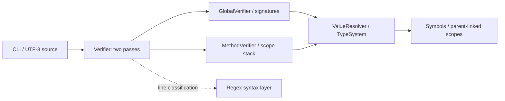

# Sjava semantic verifier

A small Java program that checks a restricted Java-like language without executing it or producing bytecode. It resolves names across lexical scopes, tracks initialization, validates method signatures and calls, and enforces a five-type assignment contract.

Originally developed by **Roee Tekoah and Ofri Mordechai** for the Hebrew University of Jerusalem object-oriented programming course. This portfolio edition preserves the joint implementation and adds reproducible packaging, original examples, documentation, and a few bounded repairs. See [authorship and provenance](docs/provenance.md).

## Build and try it

Use a full **JDK 17 or newer**, with `java` on your path. No build manager, downloaded libraries, IDE, or network access is needed. From the repository root, on Windows, macOS, or Linux:

```text
java tools/Project.java build
java -jar build/sjava-verifier.jar corpus/valid/walkthrough.sjava
java -jar build/sjava-verifier.jar corpus/invalid/uninitialized_local.sjava
java tools/Project.java test
```

The two example runs print `0` and `1`, respectively. The invalid example also reports `Verification error at line 3: Variable used before initialization: x` on stderr. The equivalent class entry point is:

```text
java -cp build/classes ex5.main.Sjavac corpus/valid/walkthrough.sjava
```

Compilation targets Java 17 bytecode and treats all compiler warnings as errors. The build and test route has been exercised on Windows with JDK 17.0.12 and JDK 27; other operating systems have not been tested locally. [JDK downloads](https://www.oracle.com/java/technologies/downloads/).

## Result contract

| Stdout | Meaning | Stderr |
|---|---|---|
| `0` | Accepted source | Empty |
| `1` | Syntax or semantic violation | One diagnostic with a one-based source line |
| `2` | Invalid CLI input or file-reading failure | One diagnostic |

These digits are printed results, **not process exit codes**. Handled outcomes exit normally with process status zero, preserving the coursework CLI. Use stdout when integrating the verifier. Input is a single UTF-8 file with the case-sensitive `.sjava` suffix.

## What it checks

- `int`, `double`, `boolean`, `char`, and `String`; initialization and `final` constraints.
- Global, method, and nested block scopes, including shadowing and nearest-name lookup.
- Void methods, positional arguments, forward calls, recursion, and a final method-level `return;`.
- `if`/`while` conditions containing initialized numeric/boolean atoms joined by `&&` or `||`.

Initialization follows source order within a method, including assignments inside unreachable branches. It is deliberately not Java's path-sensitive definite-assignment analysis. Arithmetic, arrays, objects, value-returning methods, and general expressions are outside the language. Read the [precise language contract and limitations](docs/language.md) before treating acceptance as a correctness guarantee.



The [design walkthrough](docs/architecture.md) traces the sample through both passes and explains why global initialization is isolated per method.

## Evidence and scope

The suite checks **93 CLI corpus programs** (28 valid, 65 invalid), **10 CLI input/error cases**, and **111 generated semantic cases**, including every source/target type pair in four contexts, renaming, whitespace changes, method reordering, and bounded nesting. [Corpus manifest](corpus/cases.tsv) · [test guide](tests/README.md).

This is a compact language-tooling project, with no AST, optimizer, execution engine, or claim of full Java compatibility. The release changes are listed in [CHANGES.md](CHANGES.md). No general reuse license has been added; see [NOTICE.md](NOTICE.md).
